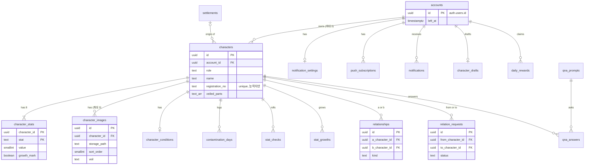
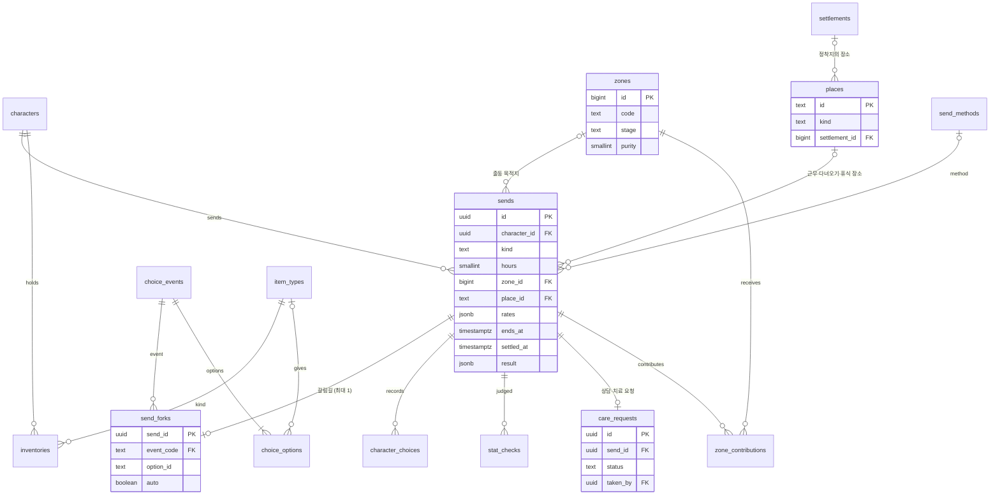
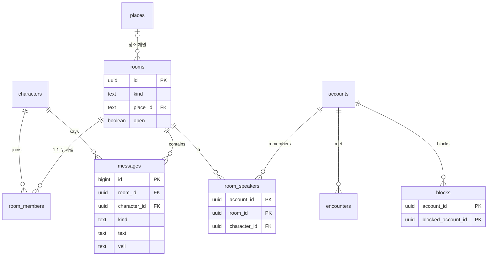
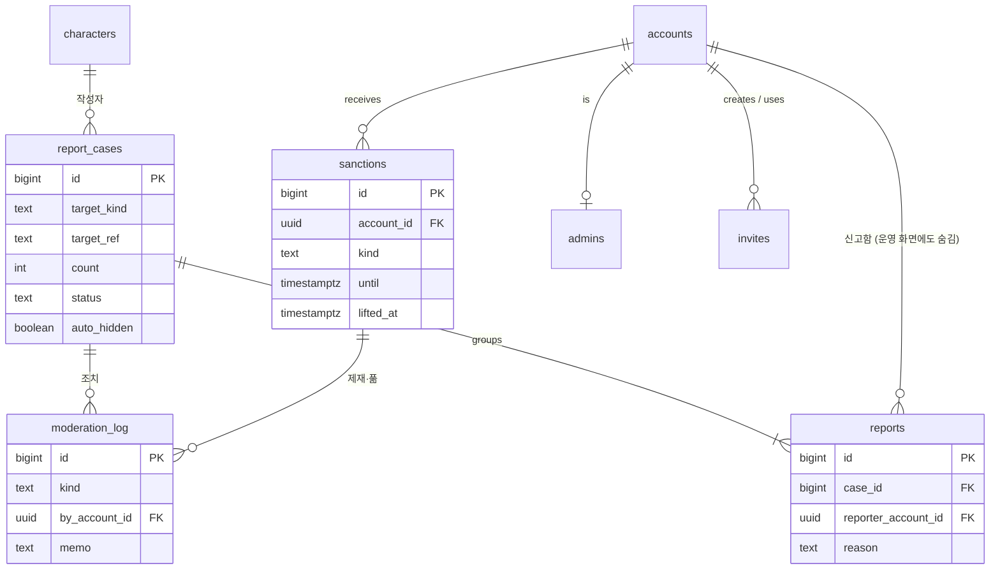

# 데이터 모델

> 마이그레이션을 만들기 전에 읽는다. 테이블 이름과 컬럼은 이 파일을 따르고, 바꿀 때는 이 파일을 먼저 고친다.
> 세계관 원본은 설정집이다. 이 파일과 설정집이 다르면 설정집이 우선이다.
> 상태: **제안 (2026-11-03)**. 운영자가 "정할 것"을 정하면 확정으로 바꾼다.

## 1. 원칙

### 스키마 나누기

| 스키마 | 무엇을 두나 | 브라우저에서 |
| --- | --- | --- |
| `public` | 게임 데이터 (캐릭터, 보내두기, 대화, 관계, 콘텐츠 시드) | 테이블마다 정한 만큼만 읽기. 쓰기는 없다 |
| `api` | 화면이 부르는 서버 함수(RPC) | 로그인한 사람만 부른다 |
| `private` | 신고 원본, 조치 기록, 제재, 초대 코드, 운영자, 금칙어, 단서 원문 | 닿지 않는다. 운영자도 `api`의 운영 함수로만 본다 |

- Supabase는 2026-10-30부터 새 테이블을 Data API에 자동으로 열지 않는다. 테이블마다 **필요한 권한을 직접 주고(GRANT), RLS를 켜고, 정책을 만드는 것을 한 마이그레이션에 함께** 넣는다.
- 브라우저 역할(`anon`, `authenticated`)에는 `select`만 준다. `insert`, `update`, `delete`는 어떤 테이블에도 주지 않는다. 모든 쓰기는 `api` 함수가 한다 (CLAUDE.md 보안 규칙 1, 3).
- Supabase 대시보드의 Data API 설정에서 노출 스키마에 `api`를 더한다. `private`는 넣지 않는다.
- `anon`(로그인 전)은 테이블을 읽지 못한다. 로그인 전에 필요한 것(초대 코드 확인)은 함수 하나로 연다.

### 서버 함수

- 게임 규칙이 있는 쓰기(판정, 보상, 오염, 주고받기)는 `api` 스키마의 `security definer` 함수가 한다. 테이블에 쓰기 권한을 주지 않으므로 이 방법뿐이다.
- 그래서 함수마다 **첫 줄에서 `auth.uid()`로 호출자를 확인**하고, 캐릭터를 다루면 그 캐릭터의 주인인지 본다. 운영 함수는 `private.admins`를 본다.
- 함수는 `set search_path = ''`로 만들고, 실행 권한은 `PUBLIC`에서 거두고 `authenticated`에만 준다.
- 남의 캐릭터는 테이블로 직접 읽지 않고 함수(`api.get_dossier`, `api.list_directory`)로 읽는다. 운영자가 가린 칸과 주인이 숨긴 측정치를 서버가 빼고 주기 위해서다 (RLS는 줄 단위라 칸을 뺄 수 없다).
- 뷰를 만들면 `with (security_invoker = true)`로 만든다. 그렇지 않으면 뷰가 RLS를 건너뛴다.

### 이름과 형식

- 이름은 소문자 `snake_case`, 테이블은 복수형. 값의 종류는 Postgres enum 대신 `text` + `check`로 둔다 (값을 늘리기 쉽다).
- 키
  - 브라우저 주소에 나오는 것(캐릭터, 대화방, 보내두기, 관계)은 `uuid default gen_random_uuid()`. 순서 번호가 드러나지 않게 한다.
  - 많이 쌓이는 기록(말, 판정, 조치 기록, 알림)은 `bigint generated always as identity`.
  - 콘텐츠 시드(장소, 갈림길, 문답, 물품 종류)는 설정집의 코드를 그대로 쓰는 `text` 키 (`F09`, `clinic`).
- 시각은 모두 `timestamptz`. 날짜 계산(하루, 계절, 연차)은 `Asia/Seoul` 기준으로 서버가 한다.
- 외래 키 컬럼에는 모두 인덱스를 단다. RLS 정책이 쓰는 컬럼(`account_id`, `character_id`)도 마찬가지다.
- 글자 수 상한은 `check (char_length(x) <= n)`으로 서버에서도 건다. 값은 `src/config/balance.ts`의 `TEXT_LIMITS`와 같게 둔다.
- 오래 쓰는 계정 단위 확인을 빠르게 하려고, 캐릭터에서 나온 기록에도 `account_id`를 함께 적는다 (같은 계정 제한, 차단, RLS).

### 운영자가 가린 것

- 가릴 수 있는 것은 그 테이블에 `veil` 컬럼(`null` / `hidden` / `deleted`)을 둔다: `messages`, `character_images`, `qna_answers`. 판독지 글은 `characters.veiled_parts`(가린 칸 이름 목록).
- `hidden`은 주인과 운영자에게만 보인다. `deleted`는 내용을 비우고 줄은 남긴다 (신고와 조치 기록이 가리키는 대상이 사라지지 않게).

## 2. v0.1 테이블

표의 "읽기"는 브라우저 역할(`authenticated`)이 `select`로 읽을 수 있는 범위다. 쓰기는 모두 서버 함수다.

### 2-1. 계정과 설정

**accounts**: 플레이어 계정. Supabase Auth와 1:1.

| 컬럼 | 형식 | 설명 |
| --- | --- | --- |
| id | uuid PK | `auth.users.id` |
| invite_id | bigint FK → private.invites | 가입에 쓴 초대 코드 |
| age_confirmed_at | timestamptz | 만 14세 이상 확인 (미정 사항이 정해지기 전까지) |
| agreed_at | timestamptz | 약관·개인정보 처리방침·이용 규칙 동의 |
| left_at | timestamptz null | 탈퇴 (정할 것 1) |
| created_at | timestamptz | |

- 읽기: 본인 줄만. 이메일은 `auth.users`에 있으므로 여기 두지 않는다.

**notification_settings**: 계정별 알림 켜기·끄기.

| 컬럼 | 형식 | 설명 |
| --- | --- | --- |
| account_id | uuid PK FK → accounts | |
| send, talk, relation, care | boolean | 종류별 (기본 켬) |
| quiet_night | boolean | 밤 시간 묶어 보내기 (기본 켬) |
| updated_at | timestamptz | |

- 읽기: 본인.

**push_subscriptions**: 기기별 웹 푸시 구독.

| 컬럼 | 형식 | 설명 |
| --- | --- | --- |
| id | bigint PK | |
| account_id | uuid FK → accounts | |
| endpoint | text unique | |
| p256dh, auth | text | 구독 키 |
| created_at, last_ok_at | timestamptz | 보내기에 실패가 이어지면 지운다 |

- 읽기: 없음. 보내기는 Edge Function(service_role)이 한다.

**notifications**: 알림 기록. 푸시를 끈 사람도 "오늘 한눈에"에서 본다.

| 컬럼 | 형식 | 설명 |
| --- | --- | --- |
| id | bigint PK | |
| account_id | uuid FK → accounts | |
| character_id | uuid FK → characters null | 어느 캐릭터의 일인지 |
| kind | text check | send, talk, relation, care, system |
| body | text | |
| link | text | 누르면 갈 화면 (`#/result/...`) |
| created_at, read_at, pushed_at | timestamptz | |

- 읽기: 본인. 오래된 것은 서버 틱이 지운다 (docs/tech.md 무료 요금제).

**world_config**: 서버 설정값. 한 줄만 있다.

| 컬럼 | 형식 | 설명 |
| --- | --- | --- |
| id | smallint PK check (id = 1) | |
| data | jsonb | `src/config/worldConfig.ts`의 `WorldConfig` 모양 |
| updated_at | timestamptz | |
| updated_by | uuid FK → accounts | |

- 읽기: 로그인한 모두. 바꾸기는 운영 함수가 하고, 바꾼 칸은 `private.moderation_log`에 남긴다.

### 2-2. 캐릭터

**characters**

| 컬럼 | 형식 | 설명 |
| --- | --- | --- |
| id | uuid PK | |
| account_id | uuid FK → accounts | 계정당 3명은 서버 함수가 센다 |
| role | text check | ability, staff, free |
| name | text | 20자 |
| look, personality, past, ability | text | 자유 서술 (1000, 1000, 2000, 500자). ability는 능력자만 |
| memory_loss | text null check | most, period, name, all. 능력자만 (check로 역할과 묶음) |
| pre_real_name, pre_born, pre_home, pre_job | text null | 발현 이전 기록. 말소되지 않은 칸만 (40자) |
| origin_settlement_id | bigint FK → settlements null | |
| registration_no | text unique null | 능력자만 (`A-0388`) |
| stats_hidden | boolean | 측정치 숨기기 |
| realloc_used | boolean | 한 번 무료 재배분 |
| veiled_parts | text[] | 운영자가 가린 칸 (ability, past, look, personality) |
| created_at, updated_at | timestamptz | |

- 읽기: 본인 캐릭터만 테이블로. 남의 캐릭터는 `api.get_dossier`, `api.list_directory`, 대화 화면의 인물 정보 함수로.

**character_stats**: 능력치 8개. 캐릭터당 8줄.

| 컬럼 | 형식 | 설명 |
| --- | --- | --- |
| character_id | uuid FK → characters | PK (character_id, stat) |
| stat | text check | str, con, dex, emp, int, mind, edu, craft |
| value | smallint check (1~99) | 상한은 world_config의 성장 상한 |
| growth_mark | boolean | 판정에 성공해 성장 표시가 붙음. 새벽 틱이 굴리고 지운다 |

- 읽기: 본인.

**character_images**

| 컬럼 | 형식 | 설명 |
| --- | --- | --- |
| id | uuid PK | |
| character_id | uuid FK → characters | 캐릭터당 3장 |
| account_id | uuid FK → accounts | 저장소 정책이 쓴다 |
| storage_path | text unique | `characters/{character_id}/{id}.webp` |
| alt | text | 100자 |
| sort_order | smallint | 0이 대표 사진 |
| veil | text null | |
| created_at | timestamptz | |

- 사진 파일은 **비공개 버킷**에 둔다. 공개 버킷이면 운영자가 숨겨도 주소를 아는 사람은 계속 볼 수 있어서다. 저장소 읽기 정책이 이 테이블의 `veil`을 보고 막는다.

**character_drafts**: 만드는 중인 캐릭터 임시저장. 계정당 하나.

| 컬럼 | 형식 | 설명 |
| --- | --- | --- |
| account_id | uuid PK FK → accounts | |
| data | jsonb | `CharacterDraft` 모양 |
| updated_at | timestamptz | |

**character_conditions**: 능력자의 지금 오염과 접속 기록.

| 컬럼 | 형식 | 설명 |
| --- | --- | --- |
| character_id | uuid PK FK → characters | |
| contamination | smallint check (0~100) | 능력자만 의미가 있다 |
| contamination_at | timestamptz | 자연 감소를 계산한 마지막 때 |
| overload_until | timestamptz null | 폭주 |
| login_streak | smallint | 연속 접속 (끊겨도 0으로 돌리지 않는다) |
| last_login_day | date | 한국 날짜 |

- 읽기: 본인. 남에게 보이는 판독지 오염 그래프는 `get_dossier`가 준다.

**contamination_days**: 판독지 "최근 7일 오염".

| 컬럼 | 형식 | 설명 |
| --- | --- | --- |
| character_id | uuid FK → characters | PK (character_id, day) |
| day | date | 한국 날짜 |
| value | smallint | 그날의 마지막 값 |

**stat_checks**: 판정 기록. 결과 화면의 "근력 42 / 55 · 성공"이 여기서 나온다.

| 컬럼 | 형식 | 설명 |
| --- | --- | --- |
| id | bigint PK | |
| character_id | uuid FK → characters | |
| send_id | uuid FK → sends null | |
| source | text check | send, fork, push (v0.3에 expedition) |
| stat | text | |
| target, penalty, value | smallint | 기준, 감점, 굴린 값 |
| grade | text check | crit, extreme, hard, success, fail, fumble |
| created_at | timestamptz | |

**stat_growths**: 새벽 성장 굴림 기록. "교감 +4 (52 → 56)".

| 컬럼 | 형식 | 설명 |
| --- | --- | --- |
| id | bigint PK | |
| character_id | uuid FK → characters | |
| stat | text | |
| roll | smallint | |
| before, after | smallint | 오르지 않았으면 같다 |
| day | date | |

### 2-3. 세계와 장소

**settlements**: 정착지. 시드 3곳(새벽뜰, 누에바 에스페란사, 스텔라), 플레이어가 더 등록한다.

| 컬럼 | 형식 | 설명 |
| --- | --- | --- |
| id | bigint PK | |
| name | text unique | |
| named_by | text null | 이름을 지은 피난민 대표 (설정) |
| story | text null | 등록자가 쓴 사연 (이야기 조각은 v0.2) |
| registered_by | uuid FK → accounts null | 시드는 null |
| created_at | timestamptz | |

**places**: 근무지, 도시의 장소, 정착지의 장소. 근무·다녀오기·휴식의 목적지이고, 장소 채널이 붙는 곳이다.

| 컬럼 | 형식 | 설명 |
| --- | --- | --- |
| id | text PK | `clinic`, `mess`, `lounge`, `saebyeok-fire` |
| name | text | |
| kind | text check | facility, city, settlement |
| settlement_id | bigint FK → settlements null | kind = settlement일 때 |
| cam | text null | 감시 화면 꼬리표 |
| image_path | text null | |
| work, outing, rest | boolean | 근무지 / 다녀오기 목적지 / 휴식 장소로 고를 수 있는지 |
| sort_order | smallint | |

**zones**: 정화 구역. 서버가 자동으로 만든다.

| 컬럼 | 형식 | 설명 |
| --- | --- | --- |
| id | bigint PK | |
| code | text unique | `E-07` |
| name | text | |
| region | text | 에브론 경계지대, 토르빈 |
| threat | text check | zombie, mutant, remnant |
| stage | text check | contaminated, purifying, purified, rebuilding |
| purity | smallint check (0~100) | 정화율 |
| opened_at, purified_at | timestamptz | |

**zone_contributions**: 누가 어느 구역에 얼마나 보탰는지. "같은 구역에 다녀간 동료" 목록이 여기서 나온다. 기여 순위는 만들지 않는다.

| 컬럼 | 형식 | 설명 |
| --- | --- | --- |
| id | bigint PK | |
| zone_id | bigint FK → zones | |
| character_id | uuid FK → characters | |
| send_id | uuid FK → sends | |
| amount | smallint | |
| created_at | timestamptz | |

### 2-4. 하루 (보내두기, 갈림길, 휴식)

**send_methods**: 보내두기 방식 시드 (정면으로, 손으로 하는 일, 먼 길을 걷는다 등).

| 컬럼 | 형식 | 설명 |
| --- | --- | --- |
| id | text PK | `front`, `hands`, `walk` |
| kind | text check | dispatch, shift, outing |
| label | text | |
| stat | text | 판정 능력치 |
| bonus | text | 성공했을 때의 덤 설명 |
| sort_order | smallint | |

**sends**: 보내두기 한 번. 출동, 근무, 다녀오기, 휴식을 한 테이블에 둔다 (화면과 정산이 같은 흐름이라서).

| 컬럼 | 형식 | 설명 |
| --- | --- | --- |
| id | uuid PK | |
| character_id | uuid FK → characters | |
| account_id | uuid FK → accounts | |
| kind | text check | dispatch, shift, outing, rest |
| hours | smallint check in (1, 4, 8) | |
| zone_id | bigint FK → zones null | 출동 |
| place_id | text FK → places null | 근무, 다녀오기, 휴식 |
| method_id | text FK → send_methods null | 휴식은 없음 |
| rest_kind | text null check | alone, together, counsel, treat, settlement |
| boost | boolean | 능력을 아끼지 않는다 |
| rates | jsonb | **보낼 때의 보상·회복 값.** 나중에 설정이 바뀌어도 이 값으로 정산한다 |
| started_at, ends_at | timestamptz | |
| settled_at | timestamptz null | 서버가 정산한 때 |
| result | jsonb null | 결과 화면에 보여 줄 문구와 얻은 것 (`SendResult` 모양) |
| seen_at | timestamptz null | 결과를 본 때 ("끝난 일" 표시) |

- check: 종류에 맞는 목적지 하나만 (출동은 zone_id, 나머지는 place_id).
- 한 캐릭터에 진행 중인 보내두기는 하나: `unique (character_id) where settled_at is null` 부분 유니크 인덱스.
- 정산 틱이 찾는 인덱스: `(ends_at) where settled_at is null`.
- 읽기: 본인 것. 장소에 "머무는 중"인 남의 캐릭터는 함수가 진행 중인 sends에서 계산해 준다 (따로 테이블을 두지 않는다).

**send_forks**: 보내두기 중 온 갈림길.

| 컬럼 | 형식 | 설명 |
| --- | --- | --- |
| send_id | uuid PK FK → sends | v0.1은 한 번에 하나 |
| character_id | uuid FK → characters | 다시 나오지 않게 하는 검사에 쓴다 |
| event_code | text FK → choice_events | |
| arrives_at | timestamptz | |
| met_character_ids | uuid[] | 상황에 실제로 들어간 다른 계정 캐릭터 |
| option_id | text null | 고른 선택지 |
| auto | boolean | 끝날 때까지 고르지 않아 자동 처리 |
| chosen_at | timestamptz null | |
| outcome | jsonb null | 결과 문구, 판정, 효과 |

- 인덱스 `(character_id, event_code)`: 그 역할의 갈림길을 다 본 뒤에야 다시 돌린다.

**character_choices**: 판독지 "선택 기록". 자동 처리는 남기지 않는다.

| 컬럼 | 형식 | 설명 |
| --- | --- | --- |
| id | bigint PK | |
| character_id | uuid FK → characters | |
| send_id | uuid FK → sends | |
| event_code | text FK → choice_events | |
| option_id | text | |
| record | text | 「명령보다 구조 요청을 따랐다」 |
| paper_from | text null check | gov, foundation |
| paper_text | text null | 정부 공문, 재단 메모 한 장 |
| hidden | boolean | 주인이 숨긴 줄 |
| created_at | timestamptz | |

**care_requests**: 상담·치료 요청 (휴식이 요청 방식일 때).

| 컬럼 | 형식 | 설명 |
| --- | --- | --- |
| id | uuid PK | |
| send_id | uuid FK → sends | |
| character_id | uuid FK → characters | 요청한 능력자 |
| kind | text check | counsel, treat |
| place_id | text FK → places | 상담실, 의료동 |
| status | text check | open, taken, expired |
| taken_by | uuid FK → characters null | 받은 재단 직원 (다른 계정만) |
| taken_at, created_at | timestamptz | |

- 읽기: 요청한 사람과 받은 사람. 재단 직원이 받을 목록은 함수가 준다.

**daily_rewards**: 매일 접속 보상. 하루에 한 번만 받게 한다.

| 컬럼 | 형식 | 설명 |
| --- | --- | --- |
| account_id | uuid FK → accounts | PK (account_id, day) |
| day | date | 한국 날짜 |
| streak | smallint | 받을 때의 연속 기록 |
| reward | jsonb | 받은 물품 |

### 2-5. 콘텐츠 시드 (비밀 아님, 마이그레이션 시드로 넣는다)

**choice_events**: 갈림길. 원본은 `docs/content/이벤트 스크립트.md`, 지금 `scripts/gen-forks.mjs`가 만드는 것과 같은 모양이다.

| 컬럼 | 형식 | 설명 |
| --- | --- | --- |
| code | text PK | `F09`, `S03` |
| roles | text[] | 비어 있으면 모든 역할 |
| title, situation | text | |
| gov | boolean | 정부 표시 갈림길 |
| season | text null check | snow, rain, truce |
| requires | text null | `origin` (출신 정착지가 있어야) |
| who | jsonb null | `{동료}` 같은 자리 |
| active | boolean | v0.1에서 뺀 것(F13, F16, C11, T20, T09)은 false |

**choice_options**: 갈림길 선택지.

| 컬럼 | 형식 | 설명 |
| --- | --- | --- |
| event_code | text FK → choice_events | PK (event_code, id) |
| id | text | A, B, C |
| label | text | |
| stat, stat_alt | text null | 판정 능력치 ("높은 쪽") |
| auto | boolean | 자동 선택지 (갈림길마다 하나) |
| result, fail, extreme | text | 결과 문구 |
| record, fail_record | text null | 선택 기록 한 줄 |
| paper | jsonb null | 공문·메모 |
| item_type_id, extreme_item_type_id | text FK → item_types null | |
| contamination, fail_contamination | smallint | |

- "[단서]"가 나오는 갈림길은 단서 원문을 넣지 않고, 서버가 조건에 맞는 단서가 있을 때만 내려준다 (v0.3).

**item_types**: 물품 종류. 원본은 `docs/content/콘텐츠 초안.md`.

| 컬럼 | 형식 | 설명 |
| --- | --- | --- |
| id | text PK | 물품 이름 그대로 또는 짧은 코드 |
| name | text unique | |
| category | text check | 재료, 재단 물자, 길에서 얻은 물건, 기념품 |
| rarity | text check | common, rare, special |
| source | text null check | dispatch, shift, outing (어디서 나오나) |
| tradable | boolean | 주고받을 수 있는지 (v0.2부터 쓴다) |

**inventories**: 캐릭터가 가진 물품. v0.1은 받고 보관만 한다.

| 컬럼 | 형식 | 설명 |
| --- | --- | --- |
| character_id | uuid FK → characters | PK (character_id, item_type_id, received) |
| item_type_id | text FK → item_types | |
| received | boolean | 남에게 받은 것 (다시 넘길 수 없다, v0.2) |
| count | integer check (>= 0) | |

**qna_prompts**: 문답 질문.

| 컬럼 | 형식 | 설명 |
| --- | --- | --- |
| id | text PK | |
| text | text | |
| occasion | text check | created, first_send, first_counsel, day_30, day_100, day_365, truce, first_snow |
| roles | text[] | 비어 있으면 모두 |

**qna_answers**

| 컬럼 | 형식 | 설명 |
| --- | --- | --- |
| id | bigint PK | |
| character_id | uuid FK → characters | unique (character_id, prompt_id) |
| prompt_id | text FK → qna_prompts | |
| answer | text | 60자 |
| public | boolean | "같은 질문에 답한 캐릭터들"에 보일지 |
| veil | text null | |
| created_at | timestamptz | |

- 읽기: 본인 것과, 남의 것 중 `public`이고 가려지지 않은 것.

### 2-6. 대화

**rooms**: 대화방.

| 컬럼 | 형식 | 설명 |
| --- | --- | --- |
| id | uuid PK | |
| kind | text check | place, dm (v0.2에 group, owner) |
| place_id | text FK → places null | 장소 채널 |
| open | boolean | 사람이 적으면 서버가 닫는다. 기록은 지우지 않는다 |
| today_line | text null | 그날의 한 줄 (오늘 메뉴 등) |
| last_message_at | timestamptz | 목록 정렬 |
| created_at | timestamptz | |

**room_members**: 1:1 방의 두 캐릭터. 장소 채널은 누구나 들어가므로 줄이 없다.

| 컬럼 | 형식 | 설명 |
| --- | --- | --- |
| room_id | uuid FK → rooms | PK (room_id, character_id) |
| character_id | uuid FK → characters | |
| account_id | uuid FK → accounts | RLS가 쓴다 |

- 같은 두 캐릭터의 1:1 방은 하나 (함수가 찾아서 열고, 없으면 만든다).

**messages**

| 컬럼 | 형식 | 설명 |
| --- | --- | --- |
| id | bigint PK | |
| room_id | uuid FK → rooms | |
| kind | text check | say, owner, system, event |
| character_id | uuid FK → characters null | 말한 캐릭터. system, event는 없음 |
| account_id | uuid FK → accounts null | |
| text | text | 1000자 |
| created_at | timestamptz | |
| fix_until | timestamptz null | 이때까지 다른 캐릭터로 바꾸거나 지울 수 있다 (2분) |
| veil | text null | |

- 인덱스 `(room_id, id desc)`: 최근 것부터 나눠 불러온다.
- 읽기: 장소 채널은 로그인한 모두, 1:1 방은 두 사람만. 가린 말은 쓴 사람에게만, 차단한 계정의 말은 빼고 (정책에서 `blocks`를 본다).
- 실시간은 Supabase Realtime의 Postgres 변경 구독을 쓴다. 구독도 RLS를 따른다.
- 장소 사건(정전, 소문)은 따로 테이블을 두지 않고 `kind = event`인 말로 넣는다.

**room_speakers**: 방마다 마지막으로 쓴 캐릭터 (다시 열면 그 캐릭터로).

| 컬럼 | 형식 | 설명 |
| --- | --- | --- |
| account_id | uuid FK → accounts | PK (account_id, room_id) |
| room_id | uuid FK → rooms | |
| character_id | uuid FK → characters | |

**encounters**: 대화해 본 적 있는 상대. "처음 만나는 사람 먼저"에 쓴다. 같은 계정 캐릭터는 넣지 않는다.

| 컬럼 | 형식 | 설명 |
| --- | --- | --- |
| account_id | uuid FK → accounts | PK (account_id, other_character_id) |
| other_character_id | uuid FK → characters | |
| first_at | timestamptz | |

**blocks**: 차단 (정할 것 2).

| 컬럼 | 형식 | 설명 |
| --- | --- | --- |
| account_id | uuid FK → accounts | PK (account_id, blocked_account_id) |
| blocked_account_id | uuid FK → accounts | 누른 캐릭터의 주인 |
| via_character_id | uuid FK → characters | 어느 캐릭터에서 눌렀는지 (화면 표시용) |
| created_at | timestamptz | |

### 2-7. 관계

**relationships**: 맺어진 관계. 두 캐릭터를 정해진 순서(작은 id가 a)로 한 줄에 둔다.

| 컬럼 | 형식 | 설명 |
| --- | --- | --- |
| id | uuid PK | |
| a_character_id, b_character_id | uuid FK → characters | check (a < b) |
| kind | text check | lost, settlement, care, trip, free |
| note | text | 자유 입력이면 관계 이름 |
| created_at | timestamptz | |

- unique (a_character_id, b_character_id, kind).
- 읽기: 로그인한 모두 (판독지 "참고인과 관계"). 관계 해제는 확인 창을 거쳐 함수가 지운다.

**relation_requests**: 관계 신청. 자관(같은 계정)은 신청 없이 바로 relationships에 들어간다.

| 컬럼 | 형식 | 설명 |
| --- | --- | --- |
| id | uuid PK | |
| from_character_id, to_character_id | uuid FK → characters | |
| kind, note | text | |
| status | text check | open, accepted, declined, withdrawn |
| created_at, answered_at | timestamptz | |

- 읽기: 보낸 사람과 받은 사람.

### 2-8. 운영 (`private` 스키마)

**private.admins**: 운영자 계정.

| 컬럼 | 형식 |
| --- | --- |
| account_id | uuid PK FK → accounts |
| created_at | timestamptz |

**private.invites**: 초대 코드 (운영 2차에서 화면).

| 컬럼 | 형식 | 설명 |
| --- | --- | --- |
| id | bigint PK | |
| code | text unique | |
| created_by | uuid FK → accounts | |
| used_by | uuid FK → accounts null | 한 번 쓰면 끝 |
| used_at, expires_at, created_at | timestamptz | |
| memo | text null | 누구에게 줬는지 운영자 메모 |

**private.report_cases**: 같은 대상에 들어온 신고를 한 건으로 묶은 것 (운영 화면의 한 줄).

| 컬럼 | 형식 | 설명 |
| --- | --- | --- |
| id | bigint PK | |
| target_kind | text check | message, profile, image, qna |
| target_ref | text | `messages.id`, `{character_id}:look`, `character_images.id`, `qna_answers.id` |
| author_character_id | uuid FK → characters | |
| author_account_id | uuid FK → accounts | |
| excerpt | text | 신고된 내용 (서버가 그 자리에서 읽어 붙인다) |
| where_text | text | 재단 기숙사 휴게실, 판독지 외형 |
| count | integer | |
| status | text check | open, done |
| auto_hidden | boolean | |
| first_at, last_at | timestamptz | |

- 부분 유니크 인덱스 `(target_kind, target_ref) where status = 'open'`: 열린 건은 대상마다 하나.

**private.reports**: 신고 한 번. 누가 신고했는지는 운영 화면에도 보여 주지 않지만, 같은 사람이 같은 대상을 여러 번 신고하지 못하게 기록한다.

| 컬럼 | 형식 | 설명 |
| --- | --- | --- |
| id | bigint PK | |
| case_id | bigint FK → private.report_cases | |
| reporter_account_id | uuid FK → accounts | unique (case_id, reporter_account_id) |
| reason | text check | harm, contact, harass, other |
| memo | text | 200자 |
| created_at | timestamptz | |

**private.moderation_log**: 모든 조치 (자동 숨김, 설정 변경 포함). 지우지 않는다.

| 컬럼 | 형식 | 설명 |
| --- | --- | --- |
| id | bigint PK | |
| at | timestamptz | |
| by_account_id | uuid FK → accounts null | null이면 자동 (신고 누적) |
| kind | text check | hide, unhide, delete, dismiss, close, warn, suspend, ban, lift, config |
| target | text | 무엇에 대한 조치인지 한 줄 |
| case_id | bigint FK → private.report_cases null | |
| sanction_id | bigint FK → private.sanctions null | |
| memo | text | |
| until | timestamptz null | 기간 정지가 풀리는 때 |

**private.sanctions**: 제재.

| 컬럼 | 형식 | 설명 |
| --- | --- | --- |
| id | bigint PK | |
| account_id | uuid FK → accounts | |
| kind | text check | warn, suspend, ban |
| reason | text | |
| at | timestamptz | |
| until | timestamptz null | 기간 정지 |
| lifted_at | timestamptz null | |
| lifted_by | uuid FK → accounts null | |

- 정지된 계정은 로그인은 되지만 모든 쓰기 함수가 첫 줄에서 막는다 (함수 하나 `private.assert_active()`를 모든 쓰기 함수가 부른다).

**private.banned_words**: 금칙어와 연락처 패턴 (운영 2차). 저장소에는 넣지 않고 운영 화면으로 입력한다.

| 컬럼 | 형식 | 설명 |
| --- | --- | --- |
| id | bigint PK | |
| pattern | text | 낱말 또는 정규식 |
| is_regex | boolean | |
| created_at | timestamptz | |

**announcements**: 공지 (운영 2차).

| 컬럼 | 형식 | 설명 |
| --- | --- | --- |
| id | bigint PK | |
| title, body | text | |
| published_at | timestamptz null | null이면 초안 |
| created_by | uuid FK → accounts | |

- 읽기: 로그인한 모두 (published_at이 있는 것만).

## 3. v0.2 이후 테이블 (이름과 용도만)

화면을 만들 때 이 절을 2장처럼 자세히 채운다.

| 단계 | 테이블 | 용도 |
| --- | --- | --- |
| v0.2 | facilities | 복지시설 상태(운영·고장·폐쇄)와 복구 진행도. `places`의 facility와 1:1 |
| v0.2 | facility_decor | 근무지별 오늘의 꾸밈 (작성자, 날짜, veil) |
| v0.2 | contributions | 시설·정착지에 보탠 물품 기록 |
| v0.2 | settlement_stages | 정착지 재건 단계와 열리는 장소 (시드) |
| v0.2 | travel_maps | 무소속이 밝힌 길과 장소, 첫 방문 |
| v0.2 | settlement_fragments | 정착지 이야기 조각이 풀려나온 기록 |
| v0.2 | errands | 길 위의 부탁, 정착지로 보낼 물자 |
| v0.2 | exchanges | 건네기·맞바꾸기 기록 |
| v0.2 | collective_votes | 모두의 선택 갈림길(F13, F16)의 집계 |
| v0.3 | expeditions, expedition_members, expedition_events | 동행 탐색 |
| v0.3 | field_traces, support_settings | 흔적과 지원 |
| v0.3 | zone_marks, mark_helpful | 익명 표식 |
| v0.3 | exchange_posts, gifts, decor_recipes, character_decor | 교환 게시판, 선물, 꾸미기 |
| v0.3 | private.clues, clue_discoveries | 단서 원문과 공동 수첩 |
| v0.3 | exits, rescues | 서사적 퇴장과 구조 |
| v0.3 | travel_logs, rp_posts | 여행 기록, 로그 게시판 |

## 4. 관계도

영역마다 나눠 그린다. 주요 컬럼만 적었다. GitHub에서 그림으로 보인다.

### 4-1. 계정, 캐릭터, 관계

### 4-2. 하루

### 4-3. 대화

### 4-4. 운영 (private)

## 5. 초안에서 바뀐 것

| 초안 | 바꾼 것 | 이유 |
| --- | --- | --- |
| missions, mission_participants, work_shifts, outings, rest_log | `sends` 하나 | 네 가지가 같은 흐름(보내고, 갈림길, 끝나면 정산)이고 화면도 하나로 다룬다 |
| character_state | `character_conditions` + `contamination_days` | 7일 그래프를 위해 날짜별 값을 따로 둔다 |
| room_presence | 없음 (진행 중인 sends에서 계산) | 같은 사실을 두 곳에 두면 어긋난다 |
| world_events | `messages`의 `kind = event` | 대화 흐름 안에 섞여 보이는 것이라 |
| reports | `private.report_cases` + `private.reports` | 같은 대상의 신고를 한 건으로 묶고, 같은 사람의 중복 신고를 막는다 |
| (없음) | `places` | 근무지, 다녀오기 목적지, 휴식 장소, 장소 채널이 같은 "장소"를 가리킨다 |
| (없음) | `send_forks`, `send_methods`, `character_drafts`, `room_members`, `room_speakers`, `encounters`, `zone_contributions`, `daily_rewards`, `announcements` | 지금 화면이 쓰는 데이터 중 초안에 자리가 없던 것 |
| care_actions | `care_requests`의 taken_by, taken_at | v0.1의 케어는 요청을 받는 것 하나뿐이라 |
| accounts.admin 등 | `private.admins` | 브라우저가 운영자 목록을 읽지 못하게 |

## 6. 정할 것

1. **탈퇴한 사람의 기록**: 계정을 지울 때 그 사람의 캐릭터, 말, 관계를 어떻게 하나. 외래 키의 삭제 규칙(`on delete cascade` / `set null`)이 이것으로 정해진다.
2. **차단 단위**: 지금 화면은 캐릭터를 눌러 차단한다. 그 주인의 모든 캐릭터를 함께 가릴지(계정 단위, 지금 표의 안), 그 캐릭터만 가릴지.
3. **오래된 말 정리**: 대화와 로그는 지우지 않는 것이 원칙이다. 무료 요금제 DB 500MB에 닿기 전에 어떻게 할지(유료 전환, 오래된 장소 채널 말만 보관용으로 옮기기 등)는 사용량을 보고 정한다. 지금 바로 정하지 않아도 된다.
